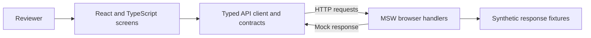
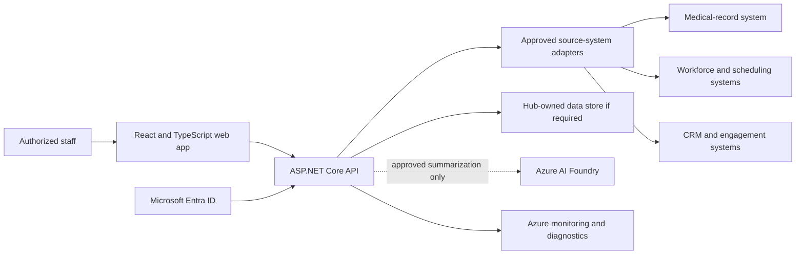

# Senior Living Intelligence Hub — Architecture Overview

**Status:** Proposed; prototype scope is the immediate priority
**Scope:** Clickable prototype now, with a production direction that can be validated later
**Business traceability:** [REQ-001 feature inventory](../../specs/requirements/REQ-001-senior-living-intelligence-hub.md)

## Architecture goals

- Demonstrate the five-screen “Identify → Understand → Act → Hand off” journey quickly.
- Keep prototype data synthetic and avoid coupling the prototype to systems that have not been identified.
- Preserve a practical path to a secure, multi-community product without building production infrastructure prematurely.
- Make surfaced concerns explainable and keep human judgment in control of resident- and workforce-impacting actions.
- Stay within the Microsoft technology choices identified for the project: .NET, TypeScript/React, Azure, and Azure AI Foundry.

## Phase 1 — Clickable prototype (priority)

### Proposed components

| Component | Responsibility |
|---|---|
| React + TypeScript web app | Present the command center, resident/family concern, resident detail, workforce detail, and shift handoff experiences. |
| Prototype role selector | Let reviewers compare Executive Director, Director of Nursing, and shift-staff perspectives. It is a demonstration control, not authentication or authorization. |
| Typed API client and contracts | Make the same product-facing HTTP requests and use the same request/response types intended for the production API. Keep UI components independent of transport details. |
| Mock Service Worker (MSW) | Intercept the prototype's API requests in the browser and return synthetic resident, activity, workforce, and handoff responses. Mock supported actions without claiming they were persisted. |
| In-browser navigation and interactions | Demonstrate opening details and selecting follow-up actions without claiming that a real assignment, contact, or handoff was persisted. |

### Prototype data flow

### Prototype constraints

- No live resident, family, employee, or health information; use synthetic examples only.
- MSW is a prototype/development mock layer, not a production API, security boundary, or persistence mechanism.
- No production authentication, authorization, persistence, EHR/CRM/scheduling integrations, or AI calls.
- Do not imply that follow-up actions were saved, sent, or assigned.
- Use clear status language and visible contributing signals; do not show unsupported predictive probabilities.
- The role selector changes the demonstration view only and must not be presented as a security control.

This keeps prototype delivery fast and bounds privacy exposure while exercising the same API boundary and contracts planned for the production web app. It intentionally does not prove that real data can be integrated or that production access controls work.

## Phase 2 — Candidate production architecture

The following is a direction for technical discovery, not an approved implementation commitment. Validate the system inventory, data permissions, identity model, and hosting standards before selecting production services.

### Components and responsibilities

| Component | Candidate responsibility |
|---|---|
| React + TypeScript web app | Provide the role-relevant hub and call the application API; do not connect directly to source systems or AI services. |
| ASP.NET Core API | Enforce user and community access, provide hub-specific use cases, compose approved source data, and persist supported workflow actions. |
| Identity and access | Use Microsoft Entra ID for workforce sign-in, with role and community authorization enforced by the API. Define the actual role matrix with Evergreen before production. |
| Source-system adapters | Isolate integration with the existing medical-record, CRM, workforce/scheduling, and other approved systems. Product names, interfaces, and data rights are not yet known. |
| Hub-owned persistence | Store only data the product must own, such as follow-up assignments or generated handoff records, after retention, privacy, and source-of-truth decisions are approved. Azure SQL is a candidate if relational persistence is needed. |
| AI capability (optional) | Use Azure AI Foundry from the server side only for approved summarization or explanation tasks. Keep the application useful when AI is unavailable. |
| Azure operations services | Host the web/API components and support secret management, application monitoring, and operational diagnostics using approved Azure services. |

### Candidate production interaction

### Production data and AI boundaries

- The API is the enforcement point for identity, authorization, community context, and access to source data.
- Access to resident health information must follow need-to-know rules. Community scoping and role permissions require client confirmation.
- Do not use health information for marketing/intake use cases without explicit authorization and privacy review.
- AI Foundry is optional, not a dependency for basic hub operation. No model, prompt, or generated content should make an autonomous care, staffing, or employment decision.
- Any generated summary should be reviewable by a human before it is treated as an action or communicated. Show the underlying approved signals so users can judge the explanation.
- Do not send PHI or employee-sensitive data to an AI model until the data flow, service configuration, contractual terms, and security/privacy approvals are confirmed.
- Preserve source attribution and timestamps for signals where available; show when information is missing or stale instead of silently treating it as current.

## Component responsibilities and dependency flow

The web app depends on product-facing API contracts, not individual source systems. In the prototype, MSW intercepts the browser's API requests and supplies synthetic responses. In production, the same client requests are handled by the ASP.NET Core API. The API owns orchestration and access checks; source adapters translate approved upstream systems into hub-facing information. AI summarization, if approved, is an optional server-side collaborator. Neither the UI nor the AI service is the source of truth for clinical records, staffing records, or CRM data.

Keep contracts in a shared, version-controlled TypeScript definition that the prototype client and MSW handlers consume. Treat those definitions as the frontend contract, with corresponding ASP.NET Core request/response types validated against them; do not require the .NET service to consume TypeScript source directly. Keep fixtures separate from handlers, and keep screen components independent of mock-specific behavior, so swapping MSW for the real API does not require redesigning the user journey.

## Deployment assumptions

### Prototype

- Run as a React web application in a development or review environment.
- Use MSW browser handlers with synthetic fixtures to answer the prototype's API requests.
- Enable the MSW worker only in prototype/development builds; production builds must send requests to the configured API and must not silently fall back to mock data.
- No Azure resource or production tenant is required by this architecture.

### Production candidate

- Host the React app and ASP.NET Core API in Azure using the organization’s approved hosting pattern.
- Use Microsoft Entra ID, managed identity where supported, and Azure Key Vault for secrets.
- Use Azure Monitor / Application Insights for operational telemetry, configured to avoid unnecessary sensitive-data capture.
- Select network boundaries, data residency, backup, disaster recovery, and environment strategy after the Azure landing zone and compliance requirements are known.
- Azure SQL is a provisional option only if the product needs its own relational state; do not copy source-system records by default.

## Technical requirements implied by this direction

1. The prototype must demonstrate the five-screen flow with synthetic API responses and without production credentials or network access.
2. The frontend must use a typed API client and stable request/response contracts; MSW handlers must implement those contracts for the prototype.
3. Production APIs must implement the same product-facing contracts, authenticate users, and authorize access by role and community before returning protected information.
4. MSW must be excluded from production behavior; API errors must not cause an implicit switch to synthetic data.
5. The prototype must support role-relevant sample views without representing the role selector as authorization.
6. Production integrations must be isolated behind adapters so unavailable or changing upstream systems do not dictate the UI contract.
7. AI functionality must be optional, explainable, and subject to human review; core viewing and navigation must not fail when AI is unavailable.
8. Logs and diagnostics must not capture PHI or sensitive employee information unless explicitly approved and protected.
9. Missing, stale, or unavailable source data must be identifiable to users and must not be presented as a confirmed current risk.

These are architecture-level requirements for refinement; they do not replace the business acceptance criteria in the feature inventory.

## Risks and trade-offs

| Risk or trade-off | Mitigation |
|---|---|
| Prototype assumptions may be mistaken for production capability. | Label fixture data and prototype-only actions; keep production integrations and security controls explicitly out of the prototype. |
| Relevant data may be unavailable or fragmented across systems. | Inventory systems and data ownership before production design; test with synthetic data first and integrate incrementally. |
| Centralizing resident information can increase privacy exposure. | Minimize copied data, enforce API-side need-to-know and community scope, and complete privacy/security review before integration. |
| AI summaries may omit or misstate important context. | Keep evidence visible, display source freshness, support human review, and provide non-AI behavior when the model is unavailable. |
| Workforce risk insights could be interpreted as individual employment predictions. | Focus on team-level observable operating signals; avoid individual predictive scoring and automated employment decisions. |
| A single hub can become a broad reporting platform before its value is proven. | Prioritize the five-screen care/workforce prototype; treat occupancy, marketing, referrals, finance, and facilities as separate discovery candidates. |
| Data-store and hosting choices may be premature. | Confirm integration contracts, data residency, retention, tenant, and landing-zone requirements before committing production infrastructure. |

## Decisions still required before production design

- Confirm prototype hosting needs; this document assumes a browser-based React prototype using MSW for mock API responses.
- Identify actual EHR/medical-record, CRM, workforce/scheduling, complaint, and handoff systems and their supported interfaces.
- Define roles, community boundaries, authorized data, and the approval process for access to health and employee information.
- Decide which actions must be persisted and which source system owns each action.
- Confirm whether the hub needs its own data store, and define retention and deletion rules before choosing its final schema.
- Confirm Azure tenant, landing-zone, hosting, network, and regional requirements.
- Decide whether AI Foundry is approved for the relevant data and specify which tasks, if any, may use it.
- Validate the intended first business outcome; occupancy and intake are material client concerns but are outside the current prototype flow.

## Alignment with the architecture guide

This overview covers the architecture overview, component responsibilities, dependency flow, data movement, deployment assumptions, and material risks/trade-offs described in this folder’s [README](./README.md). Detailed API contracts, data models, and per-feature design should be added when those decisions are ready.
